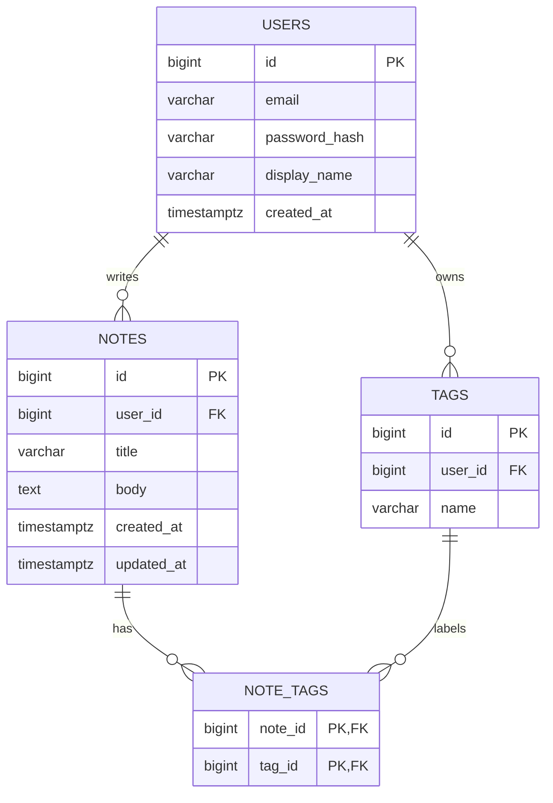

# QuickNotes Data Model

QuickNotes stores users, their notes, and tags that can be attached to notes. The SQL below targets PostgreSQL.

## 1. Entity-relationship diagram



## 2. Entities

### `users`

| Column          | Type           | Key    | Notes                              |
| --------------- | -------------- | ------ | ---------------------------------- |
| `id`            | `BIGSERIAL`    | **PK** | Auto-incrementing id               |
| `email`         | `VARCHAR(255)` |        | Required, unique                   |
| `password_hash` | `VARCHAR(255)` |        | Hashed password (never plain text) |
| `display_name`  | `VARCHAR(100)` |        | Required                           |
| `created_at`    | `TIMESTAMPTZ`  |        | Defaults to now                    |

### `notes`

| Column       | Type           | Key                 | Notes                                                        |
| ------------ | -------------- | ------------------- | ------------------------------------------------------------ |
| `id`         | `BIGSERIAL`    | **PK**              | Auto-incrementing id                                         |
| `user_id`    | `BIGINT`       | **FK** → `users.id` | The note's owner; required                                   |
| `title`      | `VARCHAR(100)` |                     | Required, max 100 characters (matches the client validation) |
| `body`       | `TEXT`         |                     | Optional, defaults to an empty string                        |
| `created_at` | `TIMESTAMPTZ`  |                     | Defaults to now                                              |
| `updated_at` | `TIMESTAMPTZ`  |                     | Defaults to now, updated on every change                     |

### `tags`

| Column    | Type          | Key                 | Notes                     |
| --------- | ------------- | ------------------- | ------------------------- |
| `id`      | `BIGSERIAL`   | **PK**              | Auto-incrementing id      |
| `user_id` | `BIGINT`      | **FK** → `users.id` | The tag's owner; required |
| `name`    | `VARCHAR(50)` |                     | Required; unique per user |

### `note_tags` (join table)

| Column    | Type     | Key                              | Notes |
| --------- | -------- | -------------------------------- | ----- |
| `note_id` | `BIGINT` | **PK (part 1), FK** → `notes.id` |       |
| `tag_id`  | `BIGINT` | **PK (part 2), FK** → `tags.id`  |       |

## 3. Relationships

- **One-to-many: users → notes.** One user writes many notes, and each note belongs to exactly one user (`notes.user_id`).
- **One-to-many: users → tags.** One user owns many tags, and each tag belongs to one user (`tags.user_id`). Tags are private to their owner.
- **Many-to-many: notes ↔ tags.** A note can have many tags (for example `work` and `urgent`) and a tag can label many notes. A relational database cannot store this directly, so the join table `note_tags` holds one row per note–tag pair. Its composite primary key `(note_id, tag_id)` prevents the same tag from being attached to a note twice.
- **Cascading deletes:** Deleting a user removes their notes and tags. Deleting a note or a tag removes the matching `note_tags` rows, so no orphan links remain.

## 4. CREATE TABLE statements

```sql
CREATE TABLE users (
    id            BIGSERIAL PRIMARY KEY,
    email         VARCHAR(255) NOT NULL UNIQUE,
    password_hash VARCHAR(255) NOT NULL,
    display_name  VARCHAR(100) NOT NULL,
    created_at    TIMESTAMPTZ  NOT NULL DEFAULT now()
);

CREATE TABLE notes (
    id         BIGSERIAL PRIMARY KEY,
    user_id    BIGINT       NOT NULL REFERENCES users(id) ON DELETE CASCADE,
    title      VARCHAR(100) NOT NULL CHECK (char_length(trim(title)) > 0),
    body       TEXT         NOT NULL DEFAULT '',
    created_at TIMESTAMPTZ  NOT NULL DEFAULT now(),
    updated_at TIMESTAMPTZ  NOT NULL DEFAULT now()
);

CREATE TABLE tags (
    id      BIGSERIAL PRIMARY KEY,
    user_id BIGINT      NOT NULL REFERENCES users(id) ON DELETE CASCADE,
    name    VARCHAR(50) NOT NULL,
    UNIQUE (user_id, name)
);

CREATE TABLE note_tags (
    note_id BIGINT NOT NULL REFERENCES notes(id) ON DELETE CASCADE,
    tag_id  BIGINT NOT NULL REFERENCES tags(id)  ON DELETE CASCADE,
    PRIMARY KEY (note_id, tag_id)
);
```

## 5. Indexes

```sql
-- Speeds up "show my newest notes", the most common query (GET /notes).
CREATE INDEX idx_notes_user_created ON notes (user_id, created_at DESC);

-- Speeds up "find all notes with this tag". The primary key already covers
-- lookups by note_id, but not by tag_id.
CREATE INDEX idx_note_tags_tag_id ON note_tags (tag_id);
```

**Reason:** Almost every request filters notes by `user_id` and sorts by newest first. Without `idx_notes_user_created`, the database would scan the whole `notes` table (millions of rows) and sort it on every page load. With the composite index it reads just the first 20 entries in order. The second index does the same for tag filtering.

## 6. Example queries

**1. Get a user's 20 newest notes (page 1 of `GET /notes`)**

```sql
SELECT id, title, body, created_at
FROM notes
WHERE user_id = 7
ORDER BY created_at DESC
LIMIT 20 OFFSET 0;
```

**2. Get a user's notes that have the tag `work` (uses JOINs)**

```sql
SELECT n.id, n.title, n.created_at
FROM notes n
JOIN note_tags nt ON nt.note_id = n.id
JOIN tags t       ON t.id = nt.tag_id
WHERE n.user_id = 7
  AND t.name = 'work'
ORDER BY n.created_at DESC;
```

**3. Create a note (`POST /notes`)**

```sql
INSERT INTO notes (user_id, title, body)
VALUES (7, 'Buy groceries', 'Milk, eggs, bread and coffee.')
RETURNING id, created_at;
```

**4. Count how many notes each tag has**

```sql
SELECT t.name, COUNT(nt.note_id) AS note_count
FROM tags t
LEFT JOIN note_tags nt ON nt.tag_id = t.id
WHERE t.user_id = 7
GROUP BY t.name
ORDER BY note_count DESC;
```

## 7. SQL or NoSQL?

QuickNotes uses a **relational (SQL) database, PostgreSQL**. The data is clearly structured and connected: users own notes, and notes and tags have a many-to-many relationship that needs joins, foreign keys and unique constraints to stay consistent (for example, no duplicate tag on a note, and no notes left behind when a user is deleted). The expected load is modest for a SQL database: about 1 million users with roughly 5 writes and 46 reads per second on average (see the load estimate in [architecture.md](architecture.md)), so a single primary with read replicas is enough, and we do not need the horizontal write scaling that is NoSQL's main advantage. If the product later needs flexible schemas or huge write volumes, a document store could be added for specific features, such as search, without replacing the core database.
